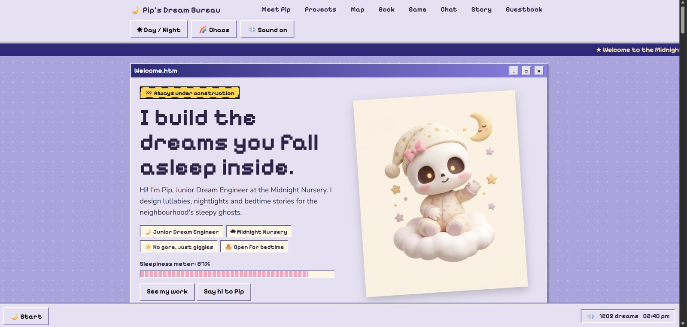
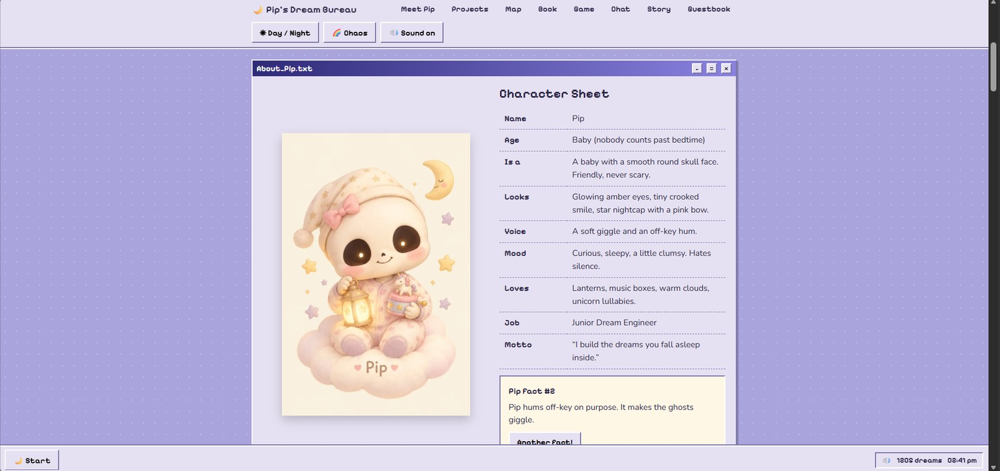
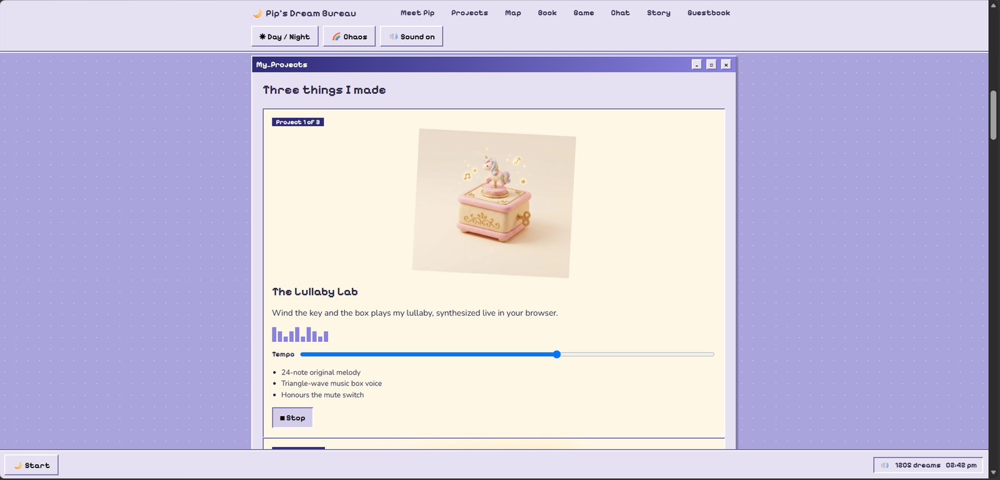
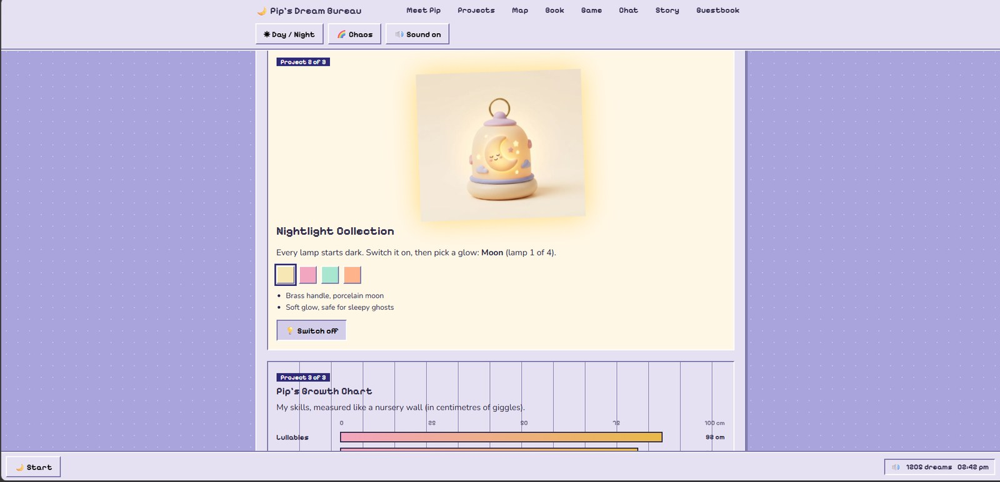
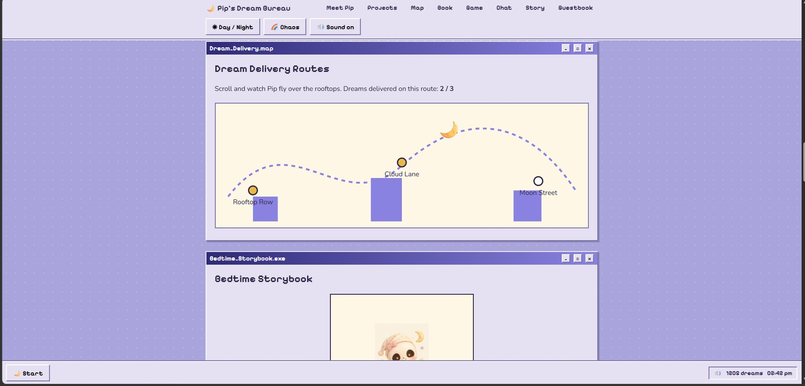
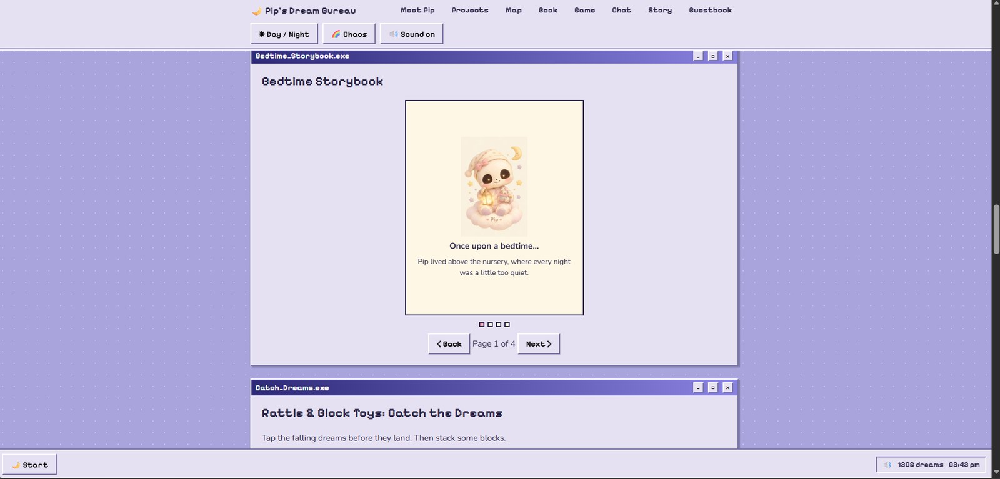
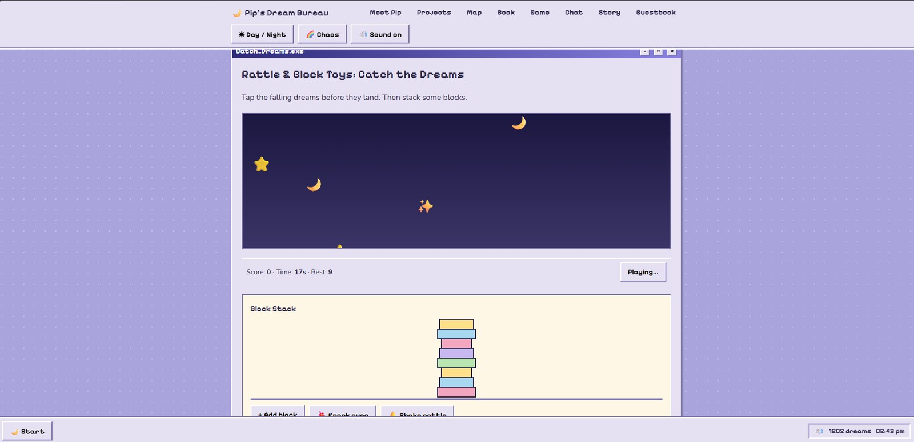
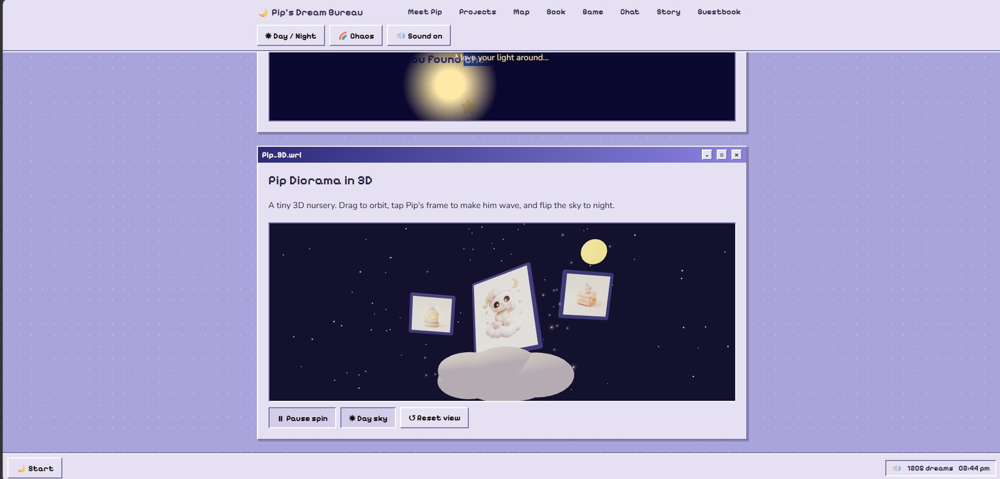
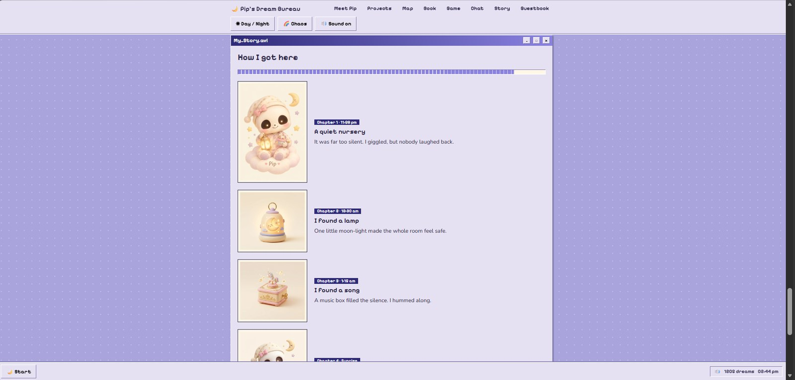

<h1 align="center">🌙 Pip's Dream Bureau</h1>

<p align="center"><b>I build the dreams you fall asleep inside.</b></p>

<p align="center">
A cozy 90s-desktop portfolio for <b>Pip</b>, the skull baby and Junior Dream Engineer at the Midnight Nursery.<br>
Built for the <b>haX.baby "Baby's First Portfolio" hackathon</b> (Track 1: Pip), 17–19 October 2026.
</p>

<p align="center">
  
  
  
  
</p>

<p align="center"><a href="https://YOUR-USERNAME.github.io/pips-dream-bureau/"><b>▶ Open the live site</b></a></p>

<p align="center">
  
</p>

---

## About the project

Pip is a sleepy, gentle baby with a round skull face and glowing eyes. The site is a Windows-95-style desktop where every section opens as a little window, with a taskbar, a Start menu and retro badges.

Visitors can meet Pip, wind a music box, switch on lamps, follow a rooftop delivery map, read a bedtime story, play games, hunt for hidden stars and chat with Pip.

## Screenshots

### Meet Pip


### Projects
| The Lullaby Lab | Nightlight Collection and Growth Chart |
|---|---|
|  |  |

### Delivery map and storybook
| Dream Delivery Routes | Bedtime Storybook |
|---|---|
|  |  |

### Games and 3D
| Catch the Dreams and Block Stack | 3D diorama and Dream Cellar |
|---|---|
|  |  |

### Pip's story


## Features

| Area | What you can do |
|---|---|
| **Character** | Pip's picture tilts toward your cursor or finger. Click Pip 5 times to find the hidden surprise |
| **Mood** | Day/Night toggle, plus a Chaos mode that tilts the windows |
| **Lullaby Lab** | Web Audio music box with a tempo slider and animated visualiser |
| **Nightlight Collection** | Switch the lamp on and choose from 4 glows |
| **Growth Chart** | Skills shown on a nursery-wall ruler |
| **Dream Delivery Routes** | A scroll-driven SVG route that lights up 3 stops |
| **Bedtime Storybook** | Page-turn animation with buttons, arrow keys and swipe |
| **Toys and games** | Catch the Dreams (20 s, saved best score), Block Stack and a rattle |
| **Dream Cellar** | A flashlight cursor that reveals 3 hidden stars |
| **3D diorama** | Orbit the scene, tap Pip's frame to make him wave, switch to a night sky |
| **Chat** | Talk to Pip. He remembers your name |
| **Extras** | Sparkle cursor trail, visitor odometer, guestbook, click sounds |
| **90s desktop** | Minimise windows, taskbar and Start menu, clock, toast messages |

## Tech stack

- **React 18**, **Vite 5** and **TypeScript**
- **Zustand** with persistence for mood, sound, visits, name, best score and wishes
- **Framer Motion** for scroll progress, the map and the growth chart
- **three.js**, **React Three Fiber** and **drei** for the lazy-loaded 3D diorama
- **Web Audio API** for the lullaby and sound effects (always with a mute switch)
- Plain CSS for the 90s theme, with a responsive layout and a mobile menu

## Getting started

You need [Node.js](https://nodejs.org/) 18 or newer.

```bash
git clone https://github.com/YOUR-USERNAME/pips-dream-bureau.git
cd pips-dream-bureau
npm install
npm run dev
```

Open the address that Vite prints, usually `http://localhost:5173`.

| Command | What it does |
|---|---|
| `npm run dev` | Start the dev server |
| `npm run build` | Build for production into `dist/` |
| `npm run preview` | Preview the production build |

## Deploy

**GitHub Pages**
1. Push to the `main` branch.
2. Open **Settings → Pages** and set the source to **GitHub Actions**.
3. The included workflow in `.github/workflows/deploy.yml` builds and publishes the site.

Vercel and Netlify also work: use the build command `npm run build` and the output folder `dist`.

## Project structure

```
src/
├── components/
│   ├── Hero.tsx, Meet.tsx        intro and character sheet
│   ├── Projects.tsx              Lullaby Lab, Nightlights, Growth Chart
│   ├── Journey.tsx               delivery map, storybook, scroll story
│   ├── Play.tsx                  games, cellar, chat, guestbook, credits
│   ├── Diorama.tsx               3D scene (lazy-loaded)
│   ├── Chrome.tsx, Win.tsx       menu bar, taskbar, toasts, window frame
├── lib/                          Zustand store, audio engine, hooks
├── assets/                       official Pip artwork (WebP)
└── index.css                     90s desktop theme
```

## Accessibility and performance

- A visible **Sound on/off** switch is always in the menu bar.
- Buttons are real `<button>` elements with labels, and the storybook works with the keyboard.
- Animations respect the "reduce motion" setting.
- The 3D code is split into its own chunk and loads only when needed.

## Known limits

- The guestbook and chat memory are stored in the visitor's browser (`localStorage`), not on a server.
- Chat replies are scripted, not AI-generated.
- The 3D diorama is built from Pip's official images placed in a 3D scene, not a modelled mesh.

## Hackathon checklist

| Requirement | Where |
|---|---|
| What Pip is | Hero and Character Sheet |
| What Pip does (3+ projects) | Lullaby Lab, Nightlight Collection, Growth Chart, plus map, storybook and toys |
| Pip's story | Scroll-driven "How I got here" and the storybook |
| Immersion | Cursor tilt, sounds with mute, games |
| Mobile friendly | Responsive layout and collapsible menu |
| Hidden Easter egg | Click Pip 5 times (and find 3 stars in the Dream Cellar) |

## Credits

- **Art:** all images are from the official haX.baby Pip Creator Asset Pack. Pip and the artwork belong to haX.baby.
- **Fonts:** Pixelify Sans and Nunito (Google Fonts, SIL Open Font License).
- **Libraries:** React, Vite, Zustand, Framer Motion, three.js, React Three Fiber, drei (all MIT).
- **Sound:** synthesised with the Web Audio API. The melody was written for this project.
- Built with Claude's help. I reviewed and tested the code myself.
