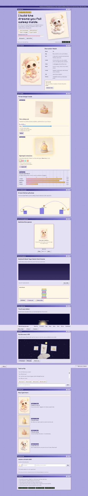
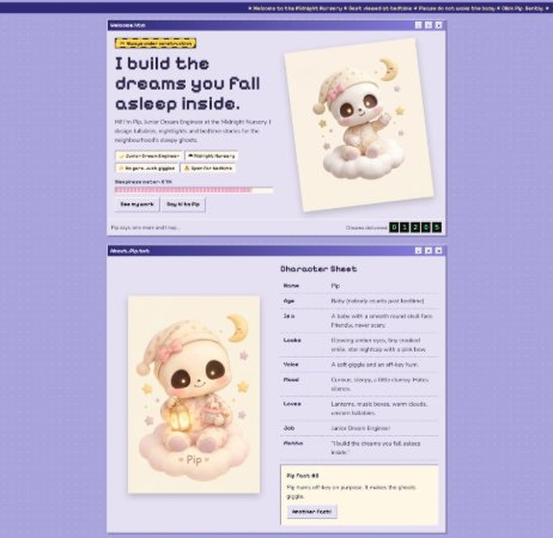
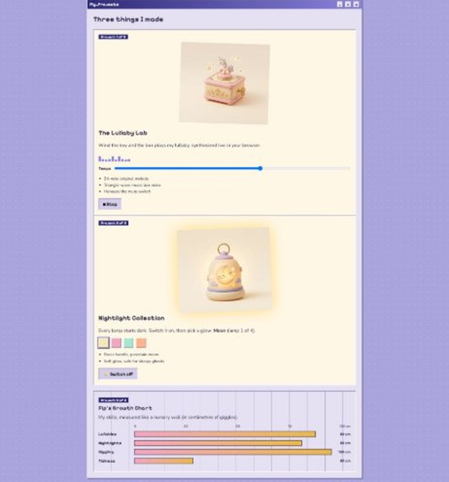
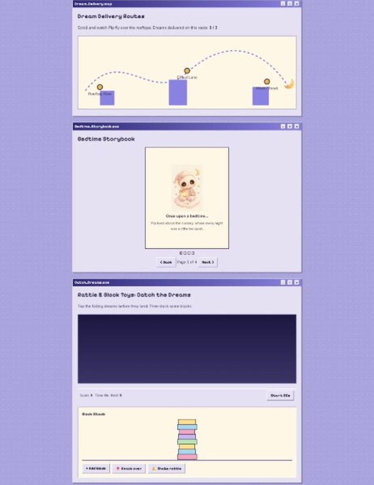
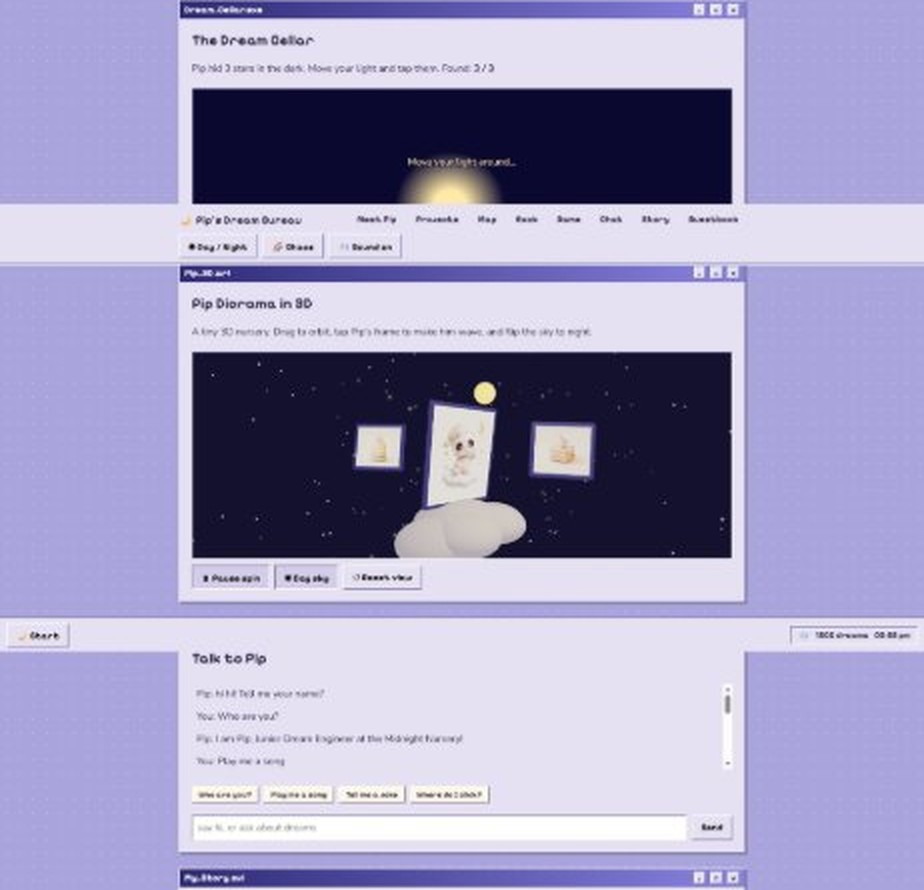
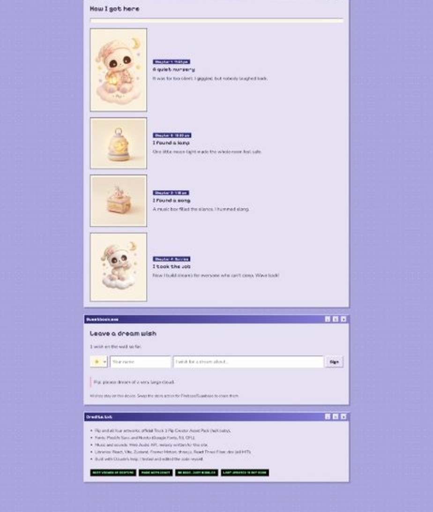

# 🌙 Pip's Dream Bureau

> **I build the dreams you fall asleep inside.**

A cozy 90s-desktop portfolio for **Pip**, the skull baby and Junior Dream Engineer at the Midnight Nursery.
Built for the **haX.baby "Baby's First Portfolio" hackathon (Track 1: Pip)**, 17–19 October 2026.

**Live site:** https://YOUR-USERNAME.github.io/pips-dream-bureau/



## Preview

### Meet Pip


### Projects: Lullaby Lab, Nightlight Collection, Growth Chart


### Delivery map, storybook and toys


### 3D diorama and chat


### Story and guestbook


## Features

| Area | What it does |
|---|---|
| Character | Pip's head tilts toward the cursor or finger; click Pip 5 times for a hidden surprise |
| Mood | Day/Night toggle and a Chaos mode that reshapes the layout |
| Projects | Lullaby Lab (Web Audio synth with tempo), Nightlight Collection (4 glows), Growth Chart |
| Story | Scroll-driven chapters, page-turn storybook (buttons, arrow keys, swipe), scroll-synced delivery map |
| Play | Catch the Dreams game, Block Stack, rattle, flashlight Dream Cellar with 3 hidden stars |
| 3D | React Three Fiber diorama: orbit, tap to wave, day/night sky |
| Extras | Sparkle cursor trail, visitor odometer, guestbook, chat that remembers your name, mute switch |
| 90s feel | Win95-style windows, taskbar with Start menu and clock, toasts, retro badges |

## Tech stack
React 18 · Vite 5 · TypeScript · Zustand (persisted state) · Framer Motion · three.js · React Three Fiber · drei · Web Audio API

## Run locally
```bash
npm install
npm run dev
```
Build with `npm run build` and preview with `npm run preview`.

## Deploy
Push to `main`, then set **Settings → Pages → Source → GitHub Actions**. The included workflow builds and publishes the site.

## Project structure
```
src/
  components/   Hero, Meet, Projects, Journey (map, storybook, story), Play (game, cellar, chat, guestbook), Diorama
  lib/          store (Zustand), audio (Web Audio), hooks
  assets/       Official Pip artwork (WebP)
  index.css     90s desktop theme
```

## Credits
- **Art:** all images are from the official haX.baby Pip Creator Asset Pack.
- **Fonts:** Pixelify Sans and Nunito (Google Fonts, SIL OFL).
- **Libraries:** React, Vite, Zustand, Framer Motion, three.js, React Three Fiber, drei (MIT).
- **Sound:** synthesized with the Web Audio API; melody written for this project.
- Built with Claude's help; code reviewed and tested by me.
